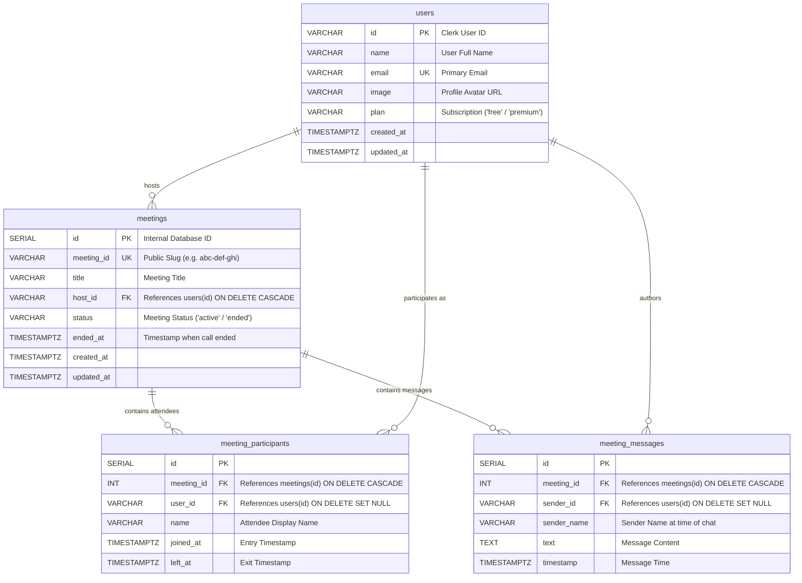
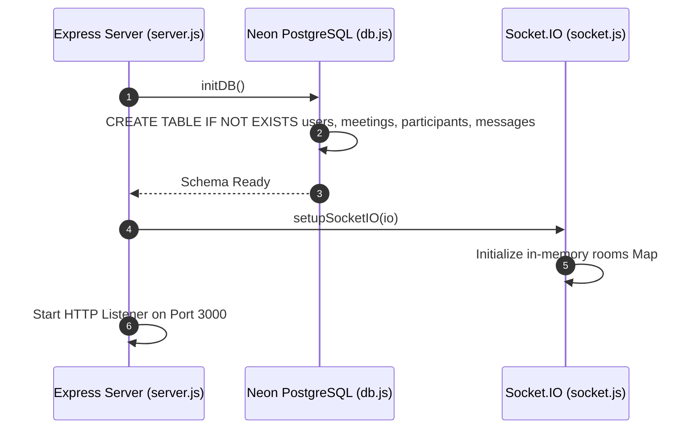
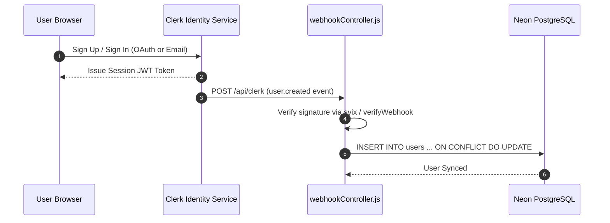
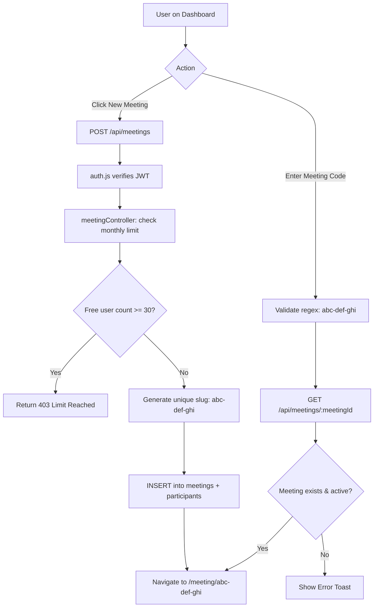
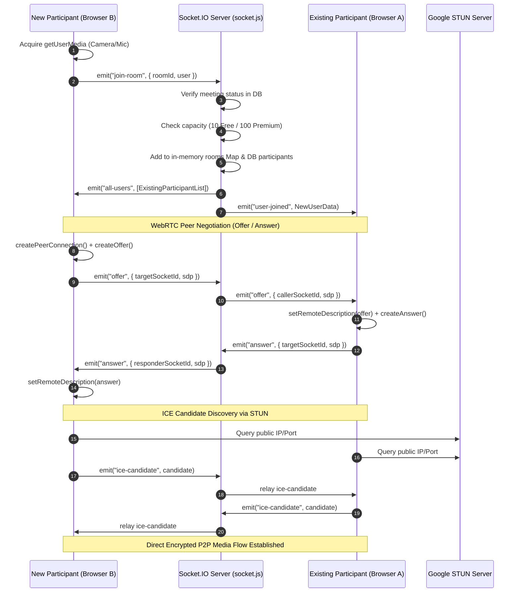
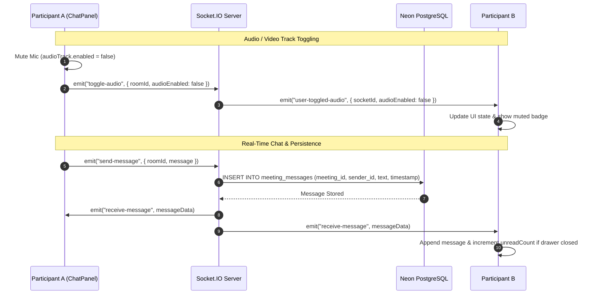
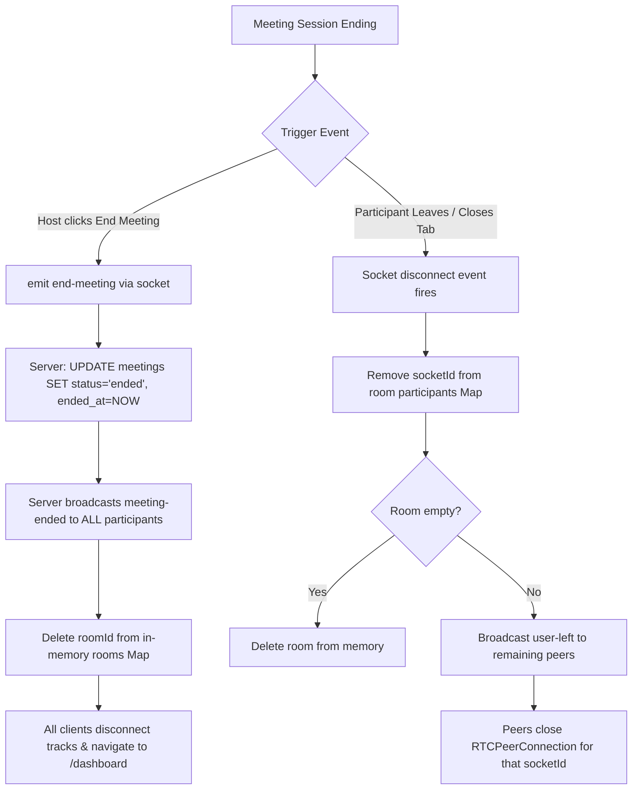
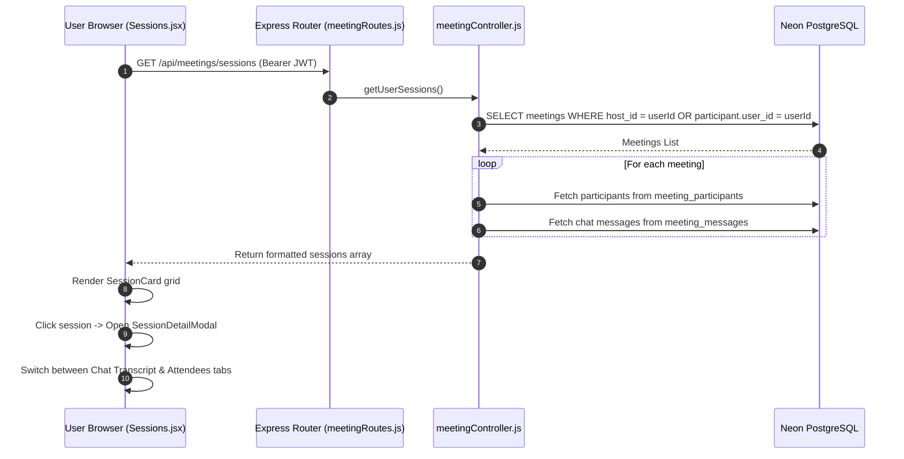
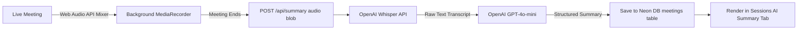

# Meetup — Project Index, File Structure & System Workflow

> **Project Name:** Meetup — Full Stack Peer-to-Peer Video Calling Web Application  
> **Architecture:** Decoupled Client-Server (React + Express + Socket.IO + WebRTC + Neon PostgreSQL + Clerk)  
> **Document Purpose:** Complete architectural indexing, directory reference, file-by-file dictionary, and step-by-step operational workflow.

---

## Table of Contents

1. [Project Overview & Architectural Index](#1-project-overview--architectural-index)
2. [Complete Directory & File Structure](#2-complete-directory--file-structure)
3. [File-by-File Dictionary](#3-file-by-file-dictionary)
   - [Root Configuration Files](#root-configuration-files)
   - [Server-Side Files (`/server`)](#server-side-files-server)
   - [Client-Side Files (`/client`)](#client-side-files-client)
4. [Database Schema & Data Relationships](#4-database-schema--data-relationships)
5. [End-to-End System Workflow (How It Works)](#5-end-to-end-system-workflow-how-it-works)
   - [Workflow 1: Application Boot & Database Initialization](#workflow-1-application-boot--database-initialization)
   - [Workflow 2: Authentication & User Sync via Webhooks](#workflow-2-authentication--user-sync-via-webhooks)
   - [Workflow 3: Dashboard & Meeting Creation/Joining](#workflow-3-dashboard--meeting-creationjoining)
   - [Workflow 4: WebRTC Signaling Handshake (Socket.IO + Google STUN)](#workflow-4-webrtc-signaling-handshake-socketio--google-stun)
   - [Workflow 5: In-Call Collaboration (Audio/Video Toggles & Chat Persistence)](#workflow-5-in-call-collaboration-audiovideo-toggles--chat-persistence)
   - [Workflow 6: Meeting Termination & Disconnection Cleanup](#workflow-6-meeting-termination--disconnection-cleanup)
   - [Workflow 7: Meeting History & Sessions Dashboard Review](#workflow-7-meeting-history--sessions-dashboard-review)
   - [Workflow 8: Planned AI Meeting Summarization Pipeline](#workflow-8-planned-ai-meeting-summarization-pipeline)
6. [API Route & Socket.IO Event Reference](#6-api-route--socketio-event-reference)
7. [Environment Variables Reference](#7-environment-variables-reference)

---

## 1. Project Overview & Architectural Index

Meetup is a modern, browser-native real-time video communication platform that removes the friction of downloading native desktop applications like Zoom or Microsoft Teams.

### High-Level Architecture

```
[ User Browser (Client) ]
   │
   ├─► REST Requests (JWT Auth) ───► Express Server (:3000) ──► Neon PostgreSQL (Database)
   │
   ├─► Real-Time Signaling (WS) ───► Socket.IO Server ────────► Neon PostgreSQL (Messages)
   │
   └─► P2P Video & Audio (WebRTC) ─► [ Direct Peer-to-Peer Connection with Other Browsers ]
         (NAT Traversal via Google STUN)
```

### Core Technologies

| Layer | Technology | Primary Functionality |
| :--- | :--- | :--- |
| **Frontend Framework** | React 19 + Vite 8 | Single Page Application (SPA), fast HMR, reactive state management |
| **Styling** | Tailwind CSS v4 | Utility-first styling, glassmorphism, responsive UI |
| **Authentication** | Clerk React & Clerk Express | Managed OAuth/Email login, session JWT issuance, auth guards |
| **Media Streaming** | Native Browser WebRTC API | Direct encrypted peer-to-peer audio and video transmission |
| **Signaling Engine** | Socket.IO v4 (Client & Server) | WebSocket connection for room clustering, SDP offer/answer, and ICE candidate exchange |
| **Backend Runtime** | Node.js (≥ v20) + Express 5 | REST API routing, webhook handling, room authorization |
| **Database** | Neon Serverless PostgreSQL | Cloud relational database for users, meetings, participants, and chat logs |
| **HTTP Client** | Axios v1 | REST communication with automatic Clerk JWT token injection |

---

## 2. Complete Directory & File Structure

```text
meetup/
├── .gitignore                                 # Git ignore rules for root
├── CONTEXT.md                                 # Technical architecture context document
├── How to Run Project.pdf                     # Setup and execution guide
├── PROJECT_INDEX_AND_WORKFLOW.md              # THIS FILE: Exhaustive indexing & workflow guide
├── generate_flowchart.py                      # Python utility for rendering flowchart graphics
├── generate_overall_flow.py                   # Python utility for widescreen flowchart generation
│
├── server/                                    # Express.js & Socket.IO Backend
│   ├── config/
│   │   └── db.js                              # Neon PostgreSQL initialization & SQL client export
│   ├── controllers/
│   │   ├── meetingController.js               # REST controllers for meeting CRUD, limits & stats
│   │   └── webhookController.js               # Clerk webhook listener (user create/update/delete)
│   ├── middleware/
│   │   └── auth.js                            # Express middleware for Clerk JWT verification & plan sync
│   ├── routes/
│   │   └── meetingRoutes.js                   # Express router endpoints for /api/meetings
│   ├── .env                                   # Server secrets (DATABASE_URL, CLERK Keys, ORIGINS)
│   ├── .gitignore                             # Server git ignore
│   ├── package.json                           # Server dependencies & scripts
│   ├── server.js                              # Application entry point, HTTP server & middleware pipeline
│   └── socket.js                              # Socket.IO room manager, signaling relay & chat handler
│
└── client/                                    # React 19 Frontend with Vite
    ├── public/
    │   ├── favicon.svg                        # Application favicon
    │   ├── icons.svg                          # Vector icon sprite
    │   ├── layout_bg.svg                      # Dashboard background vector graphic
    │   ├── login_bg.png                       # Login page background image
    │   └── logo.svg                           # Meetup branding logo
    ├── src/
    │   ├── assets/
    │   │   └── asset.js                       # Dummy fallback data and constants
    │   ├── components/
    │   │   ├── Footer.jsx                     # Global footer with links & branding
    │   │   ├── Loader.jsx                     # Full-screen / contextual loading spinner
    │   │   ├── Navbar.jsx                     # Top navigation bar with Clerk user profile & navigation
    │   │   ├── Protectedlayout.jsx            # Layout wrapper embedding Navbar + children + Footer
    │   │   ├── ProtectedRoute.jsx             # Auth guard routing unauthenticated visitors to /login
    │   │   ├── meeting/                       # Meeting room sub-components
    │   │   │   ├── ChatPanel.jsx              # Sliding drawer for real-time text chat in call
    │   │   │   ├── ControlBar.jsx             # Bottom toolbar (Mic, Cam, Chat, People, End Call)
    │   │   │   ├── ParticipantList.jsx        # Sliding drawer listing current room participants
    │   │   │   ├── VideoGrid.jsx              # Responsive grid container for active video tiles
    │   │   │   └── VideoTile.jsx              # Single video feed tile with name tag & status badges
    │   │   └── sessions/                      # Session history sub-components
    │   │       ├── EmptySessions.jsx          # Empty state illustration when no meetings exist
    │   │       ├── SessionCard.jsx            # Individual card displaying meeting summary & status
    │   │       ├── SessionChatTab.jsx         # Tab rendering full chronological chat transcript
    │   │       ├── SessionDetailModal.jsx     # Tabbed modal presenting complete meeting details
    │   │       └── SessionParticipantsTab.jsx # Tab displaying attendee names and timestamps
    │   ├── config/
    │   │   ├── api.js                         # Axios client instance with Clerk token request interceptor
    │   │   └── socket.js                      # Socket.IO singleton instance with autoConnect: false
    │   ├── hooks/
    │   │   ├── useChat.js                     # Custom hook for real-time chat emission, reception & unread count
    │   │   └── useWebRTC.js                   # Core WebRTC engine managing RTCPeerConnection and signaling
    │   ├── pages/
    │   │   ├── Dashboard.jsx                  # Main home page: live clock, usage stats, Create & Join inputs
    │   │   ├── Login.jsx                      # Dedicated authentication page rendering Clerk SignIn/SignUp
    │   │   ├── MeetingRoom.jsx                # Full-screen active video conference interface
    │   │   ├── Pricing.jsx                    # Subscription tier comparison (Free vs Premium)
    │   │   └── Sessions.jsx                   # Historical sessions grid with details modal
    │   ├── App.jsx                            # React Router route registry (public vs protected routes)
    │   ├── index.css                          # Tailwind CSS imports & global design token overrides
    │   └── main.jsx                           # Application bootstrap (ClerkProvider + BrowserRouter)
    ├── .env                                   # Client environment configuration (VITE_BASE_URL, CLERK Key)
    ├── .gitignore                             # Client git ignore
    ├── .oxlintrc.json                         # Oxlint code linter configuration
    ├── index.html                             # Single Page Application HTML root
    ├── package.json                           # Client dependencies & build scripts
    ├── README.md                              # Frontend documentation
    └── vite.config.js                         # Vite build configuration with Tailwind plugin
```

---

## 3. File-by-File Dictionary

### Root Configuration Files

| File | Purpose |
| :--- | :--- |
| `CONTEXT.md` | Comprehensive architectural and design context documenting tech stack, database schema, known bugs, and signaling flows. |
| `PROJECT_INDEX_AND_WORKFLOW.md` | Master document indexing the entire codebase, file descriptions, and system lifecycle workflows. |
| `How to Run Project.pdf` | Visual PDF guide detailing instructions for configuring and executing both frontend and backend servers. |
| `generate_flowchart.py` | Python automated script leveraging Pillow to render a high-resolution, presentation-ready flowchart diagram. |
| `generate_overall_flow.py` | Python script generating a 16:9 widescreen PowerPoint-compatible diagram of the entire application flow. |

---

### Server-Side Files (`/server`)

#### `server/server.js`
- **Role:** Main HTTP and WebSocket server entry point.
- **Key Operations:**
  - Connects to Neon PostgreSQL and initializes database schema via `initDB()`.
  - Configures CORS for frontend origin communication (`allowedOrigins`).
  - Mounts raw body parsing for Clerk webhooks at `/api/clerk`.
  - Configures standard JSON body parsing and `clerkMiddleware()`.
  - Mounts meeting REST endpoints under `/api/meetings`.
  - Initializes Socket.IO on top of the native HTTP server with CORS enabled.
  - Passes the Socket.IO instance to `setupSocketIO(io)`.
  - Hosts a centralized error handler catching uncaught exceptions.

#### `server/socket.js`
- **Role:** Real-time WebSocket signaling server and room state controller.
- **Key Operations:**
  - Maintains in-memory state via `rooms = new Map()`, tracking `roomId -> Map<socketId, participantObject>`.
  - `join-room`: Validates meeting status against PostgreSQL, checks participant limits (10 for Free, 100 for Premium), adds socket to room, persists participant to `meeting_participants`, emits `all-users` to the newcomer, and broadcasts `user-joined` to existing peers.
  - `offer`: Relays WebRTC SDP Offer from caller to target peer (`io.to(targetSocketId).emit("offer", ...)`).
  - `answer`: Relays WebRTC SDP Answer from responder back to caller (`io.to(targetSocketId).emit("answer", ...)`).
  - `ice-candidate`: Relays network candidates between peers for NAT traversal.
  - `toggle-audio` & `toggle-video`: Updates in-memory participant state and broadcasts `user-toggled-audio` / `user-toggled-video` to room members.
  - `send-message`: Validates active meeting status, executes `INSERT INTO meeting_messages`, and broadcasts `receive-message` to all room sockets.
  - `end-meeting`: Updates meeting record in DB (`status = 'ended', ended_at = NOW()`), notifies all participants via `meeting-ended`, and cleans up in-memory room map.
  - `disconnect`: Removes disconnected socket, notifies remaining peers via `user-left`, and deletes the room if empty.

#### `server/config/db.js`
- **Role:** Database client connection and table initialization.
- **Key Operations:**
  - Instantiates Neon serverless SQL client (`sql = neon(process.env.DATABASE_URL)`).
  - Defines `initDB()` which runs `CREATE TABLE IF NOT EXISTS` for all 4 tables: `users`, `meetings`, `meeting_participants`, and `meeting_messages`.

#### `server/controllers/meetingController.js`
- **Role:** REST API controllers for meetings.
- **Exported Functions:**
  - `createMeeting(req, res)`: Checks monthly meeting limits for Free users (max 30), generates a unique 9-letter code (`abc-def-ghi`), inserts meeting into DB, adds host into `meeting_participants`, and returns meeting details.
  - `getMeeting(req, res)`: Fetches a single meeting by `meetingId` slug, joins with `users` for host metadata, and ensures meeting is active.
  - `getUserSessions(req, res)`: Queries all meetings where user was either host or registered participant, returning formatted sessions with complete attendee lists and message history.
  - `getSessionDetails(req, res)`: Retrieves complete historical details, attendee logs, and chat messages for a specific session after checking user authorization.
  - `getMeetingStats(req, res)`: Computes user's current month meeting count, plan type (`free` or `premium`), and maximum capacity.

#### `server/controllers/webhookController.js`
- **Role:** Listens to Clerk authentication lifecycle events.
- **Exported Functions:**
  - `handleClerkWebhook(req, res)`: Verifies webhook signature using `verifyWebhook(req)` and `CLERK_WEBHOOK_SIGNING_SECRET`.
  - Handles `user.created`: Inserts user record into PostgreSQL with `plan = 'free'` using `ON CONFLICT (id) DO UPDATE`.
  - Handles `user.updated`: Synchronizes modified name, email, or profile image.
  - Handles `user.deleted`: Removes user from `users` table (cascading across hosted meetings).

#### `server/middleware/auth.js`
- **Role:** Express middleware validating Clerk authentication.
- **Key Operations:**
  - Extracts userId from request via Clerk's `getAuth(req)`.
  - Rejects unauthenticated requests with HTTP 401.
  - Dynamically checks if Clerk session has `plan: "premium"`.
  - Synchronizes and updates user's plan in PostgreSQL if it differs from the active Clerk subscription.

#### `server/routes/meetingRoutes.js`
- **Role:** Express router mapping HTTP methods to meeting controllers.
- **Endpoints:**
  - `POST /` ➔ `createMeeting` (Protected)
  - `GET /stats` ➔ `getMeetingStats` (Protected)
  - `GET /sessions` ➔ `getUserSessions` (Protected)
  - `GET /sessions/:id` ➔ `getSessionDetails` (Protected)
  - `GET /:meetingId` ➔ `getMeeting` (Protected)

---

### Client-Side Files (`/client`)

#### `client/src/main.jsx`
- **Role:** Frontend bootstrapping file.
- **Key Operations:** Wraps root application with `<ClerkProvider publishableKey={...}>` and `<BrowserRouter>`.

#### `client/src/App.jsx`
- **Role:** Top-level route registry and layout orchestrator.
- **Key Operations:**
  - Configures `<Toaster />` for notifications.
  - Registers public routes: `/login` and `/register`.
  - Registers private routes under `<ProtectedRoute />`:
    - Layout wrapped: `/dashboard`, `/sessions`, `/pricing` inside `<Protectedlayout />`.
    - Standalone full-screen: `/meeting/:meetingId` rendering `<MeetingRoom />`.
  - Default redirect: `*` redirects to `/dashboard`.

#### `client/src/config/api.js`
- **Role:** Axios client configuration with dynamic token interceptor.
- **Key Operations:**
  - Sets `baseURL` to `VITE_BASE_URL` (defaults to `http://localhost:3000`).
  - Sets `withCredentials: true`.
  - Attaches request interceptor checking `window.Clerk.session.getToken()` and injecting `Authorization: Bearer <token>`.

#### `client/src/config/socket.js`
- **Role:** Singleton client instance for Socket.IO.
- **Key Operations:** Initializes `io(SOCKET_URL, { autoConnect: false, withCredentials: true })`. Allows manual connection control on joining/leaving rooms.

#### `client/src/hooks/useWebRTC.js`
- **Role:** Core WebRTC engine and signaling orchestration hook.
- **Key Operations:**
  - Requests camera and microphone streams via `navigator.mediaDevices.getUserMedia`.
  - Features audio-only fallback if camera access fails.
  - Manages `RTCPeerConnection` instances mapped by `socketId` in `peersRef`.
  - Handles STUN server configuration using Google public STUN (`stun:stun.l.google.com:19302`).
  - Emits and listens to Socket.IO signaling events: `join-room`, `all-users`, `user-joined`, `offer`, `answer`, `ice-candidate`, `user-toggled-audio`, `user-toggled-video`, `user-left`, `meeting-ended`.
  - Exposes track toggle handlers (`toggleAudio`, `toggleVideo`) and `endMeeting()`.

#### `client/src/hooks/useChat.js`
- **Role:** Real-time chat communication hook.
- **Key Operations:**
  - Listens for incoming `receive-message` socket events and appends them to message state.
  - Tracks `unreadCount` which increments whenever incoming messages arrive while chat panel is closed.
  - Exposes `sendMessage(text)` which emits `send-message` to Socket.IO.
  - Exposes `toggleChat()` which flips drawer state and resets unread count.

#### `client/src/pages/Dashboard.jsx`
- **Role:** Authenticated home dashboard.
- **Key Operations:**
  - Displays user greeting and live real-time clock card.
  - Queries `/api/meetings/stats` for monthly meeting quota usage.
  - Features **"New Meeting"** button triggering meeting generation.
  - Features **"Join Meeting"** input box with regex pattern validation (`/^[a-z]{3}(?:-[a-z]{3}){2}$/`).

#### `client/src/pages/MeetingRoom.jsx`
- **Role:** Active video conference room page.
- **Key Operations:**
  - Pre-validates meeting existence and active status via `GET /api/meetings/:meetingId` before turning on user media.
  - Initializes `useWebRTC` and `useChat` hooks.
  - Determines host status (`isHost = user.id === meeting.host.id`).
  - Houses the top header, the responsive `<VideoGrid />`, the `<ChatPanel />` drawer, the `<ParticipantList />` drawer, and the bottom `<ControlBar />`.
  - Coordinates leave room vs. end meeting for everyone.

#### `client/src/pages/Sessions.jsx`
- **Role:** Past meeting history and transcript review page.
- **Key Operations:**
  - Fetches all user sessions from `/api/meetings/sessions`.
  - Renders `<SessionCard />` grid or `<EmptySessions />` state.
  - Opens `<SessionDetailModal />` displaying participant attendance and chat transcripts.

#### `client/src/pages/Login.jsx`
- **Role:** Authentication page.
- **Key Operations:** Renders Clerk's `<SignIn />` or `<SignUp />` components in a styled responsive card.

#### `client/src/pages/Pricing.jsx`
- **Role:** Subscription plan comparison page (Free vs Premium).

---

## 4. Database Schema & Data Relationships

The application uses **Neon Serverless PostgreSQL**. The schema consists of 4 normalized tables connected via foreign key relationships:



### Cascade & Integrity Rules:
1. **Host Deletion (`ON DELETE CASCADE`):** If a user is deleted from Clerk, all meetings they hosted are deleted, cascading to their messages and participant records.
2. **Participant Integrity (`ON DELETE SET NULL`):** If a user who participated in a meeting is deleted, their participation record remains intact with `user_id = NULL` and `name` preserved.
3. **Meeting Deletion (`ON DELETE CASCADE`):** Deleting a meeting purges all associated participants and message logs.

---

## 5. End-to-End System Workflow (How It Works)

### Workflow 1: Application Boot & Database Initialization



1. `server.js` triggers `initDB()` from `config/db.js`.
2. Neon executes SQL statements ensuring tables exist.
3. Express configures CORS, cookie-parser, Clerk middleware, and meeting routes.
4. An HTTP server is created and wrapped with Socket.IO.
5. `setupSocketIO` initializes socket listeners and in-memory room storage.

---

### Workflow 2: Authentication & User Sync via Webhooks



1. The user logs in via Clerk on `<Login />`.
2. Clerk issues a cryptographically signed JWT.
3. Concurrently, Clerk fires a secure webhook to `POST /api/clerk`.
4. `webhookController.js` validates signature and inserts/updates the `users` table.
5. On every subsequent protected API call, `auth.js` middleware verifies the JWT and synchronizes the active plan tier.

---

### Workflow 3: Dashboard & Meeting Creation/Joining



1. **Stats Retrieval:** Dashboard fetches usage data from `GET /api/meetings/stats`.
2. **Creation:** Clicking "New Meeting" sends `POST /api/meetings`.
3. Server validates user plan: Free users cannot exceed 30 meetings per calendar month.
4. Server generates a collision-free 9-letter code (`abc-def-ghi`), inserts the record into PostgreSQL, and navigates to the meeting room.
5. **Joining:** A user enters a code, the client validates the regex `/^[a-z]{3}(?:-[a-z]{3}){2}$/`, verifies the meeting via `GET /api/meetings/:meetingId`, and redirects to `<MeetingRoom />`.

---

### Workflow 4: WebRTC Signaling Handshake (Socket.IO + Google STUN)



1. **Media Capture:** `<MeetingRoom />` initializes `useWebRTC`, requesting local camera and audio tracks.
2. **Room Entry:** Socket client connects and emits `join-room`.
3. **Capacity Check:** Server checks `rooms.get(roomId).size`. If limit is reached, it emits `meeting-ended` with a capacity alert.
4. **Peer Discovery:** Newcomer receives `all-users` array; existing members receive `user-joined`.
5. **SDP Handshake:** For every peer, the newcomer generates an SDP Offer, transmitted via Socket.IO. The peer applies it, generates an SDP Answer, and sends it back.
6. **ICE Exchange:** Google STUN resolves NAT/firewall addresses; candidates are exchanged via socket.
7. **Direct Media:** Once connected, audio and video streams flow directly between browsers with zero server bandwidth consumption.

---

### Workflow 5: In-Call Collaboration (Audio/Video Toggles & Chat Persistence)



1. **Hardware Muting:** Clicking mic or camera toggles the track's `.enabled` property in `localStreamRef`.
2. **State Broadcast:** Emits `toggle-audio` or `toggle-video`; the server broadcasts this state so peer tiles render muted icons.
3. **Chat Transmission:** Sending a message emits `send-message`.
4. **Dual Execution:**
   - **Persistent Storage:** The server immediately executes an `INSERT INTO meeting_messages` query in PostgreSQL.
   - **Instant Broadcast:** The server broadcasts `receive-message` to all connected clients in the room.

---

### Workflow 6: Meeting Termination & Disconnection Cleanup



1. **Host Termination:**
   - Host clicks "End Meeting" in `<ControlBar />`.
   - `socket.emit("end-meeting")` updates the database record to `status = 'ended'`.
   - Server broadcasts `meeting-ended` to every attendee.
   - All client instances close camera tracks, destroy peer connections, and redirect to the dashboard.
2. **Individual Exit:**
   - A participant closes their tab or clicks "Leave".
   - The server catches `disconnect`, deletes the socket from the room map, and emits `user-left`.
   - Remaining participants close that specific `RTCPeerConnection` and remove their video tile.

---

### Workflow 7: Meeting History & Sessions Dashboard Review



1. When navigating to `/sessions`, the client requests `GET /api/meetings/sessions`.
2. The server queries meetings where the user was either the host or an attendee.
3. For each session, it compiles attendee records and chat messages.
4. The client renders cards displaying meeting date, duration status, participant count, and message count.
5. Clicking a session opens `<SessionDetailModal />`, allowing users to inspect the full chat transcript and attendance history.

---

### Workflow 8: Planned AI Meeting Summarization Pipeline



1. **Audio Ingestion:** During the live call, the Web Audio API combines local and remote audio into a single stream recorded by `MediaRecorder`.
2. **Automatic Upload:** When the meeting concludes, the audio blob is submitted to the backend.
3. **Speech-to-Text:** The audio is forwarded to OpenAI Whisper (`whisper-1`) to produce an accurate textual transcript.
4. **Intelligent Summarization:** The transcript is passed to GPT-4o-mini with structured prompts extracting:
   - Executive Overview
   - Key Discussion Topics
   - Agreed Decisions
   - Action Items & Assigned Owners
5. **Persistence & Presentation:** The summary is saved to the `meetings` record and rendered in a dedicated **AI Summary** tab inside `<SessionDetailModal />`.

---

## 6. API Route & Socket.IO Event Reference

### REST API Endpoints (`/api/meetings`)

| Method | Endpoint | Auth Required | Description |
| :--- | :--- | :---: | :--- |
| `POST` | `/api/meetings` | Yes | Creates a new meeting (enforces monthly limits for Free tier). |
| `GET` | `/api/meetings/stats` | Yes | Returns user's plan, monthly meetings used, and participant capacity limits. |
| `GET` | `/api/meetings/sessions` | Yes | Retrieves all historical and active meetings for the current user. |
| `GET` | `/api/meetings/sessions/:id`| Yes | Returns detailed meeting metadata, participants, and chat logs. |
| `GET` | `/api/meetings/:meetingId` | Yes | Validates if a meeting exists and is currently active. |
| `POST` | `/api/clerk` | No (Webhook) | Receives Clerk webhook events (`user.created`, `user.updated`, `user.deleted`). |

---

### Socket.IO Event Matrix

#### Client ➔ Server Events
| Event Name | Payload | Functional Purpose |
| :--- | :--- | :--- |
| `join-room` | `{ roomId, user, audioEnabled, videoEnabled }` | Request to join meeting room and register participant. |
| `offer` | `{ targetSocketId, callerSocketId, sdp }` | Send WebRTC SDP Offer to a specific peer. |
| `answer` | `{ targetSocketId, responderSocketId, sdp }`| Send WebRTC SDP Answer back to caller. |
| `ice-candidate` | `{ targetSocketId, senderSocketId, candidate }` | Transmit network connection candidate to peer. |
| `toggle-audio` | `{ roomId, audioEnabled }` | Broadcast microphone state change. |
| `toggle-video` | `{ roomId, videoEnabled }` | Broadcast camera state change. |
| `send-message` | `{ roomId, message }` | Save chat message to DB and broadcast to room. |
| `end-meeting` | `{ roomId }` | Host command to terminate meeting for all attendees. |

#### Server ➔ Client Events
| Event Name | Payload | Functional Purpose |
| :--- | :--- | :--- |
| `all-users` | `Array<UserObject>` | Sent to newcomer containing existing participants in room. |
| `user-joined` | `UserObject` | Broadcast to existing participants when a newcomer enters. |
| `offer` | `{ callerSocketId, sdp, callerUser }` | Relays SDP offer to target peer. |
| `answer` | `{ responderSocketId, sdp }` | Relays SDP answer back to caller. |
| `ice-candidate` | `{ senderSocketId, candidate }` | Relays ICE candidate to target peer. |
| `user-toggled-audio`| `{ socketId, audioEnabled }` | Notifies room peers of a participant's mic status. |
| `user-toggled-video`| `{ socketId, videoEnabled }` | Notifies room peers of a participant's camera status. |
| `receive-message` | `{ ...message, senderSocketId }` | Broadcasts real-time chat message to all attendees. |
| `user-left` | `{ socketId, user }` | Notifies room peers when a participant disconnects. |
| `meeting-ended` | `{ message }` | Signals all attendees that the meeting has terminated. |

---

## 7. Environment Variables Reference

### Backend (`server/.env`)
```env
# Allowed Frontend Origins (CORS)
ORIGINS="http://localhost:5173,http://localhost:3000"

# Neon Serverless PostgreSQL Connection String (with Connection Pooling)
DATABASE_URL='postgresql://<user>:<password>@<host>-pooler.<region>.aws.neon.tech/neondb?sslmode=require&channel_binding=require'

# Clerk Authentication API Keys
CLERK_PUBLISHABLE_KEY=pk_test_...
CLERK_SECRET_KEY=sk_test_...
CLERK_WEBHOOK_SIGNING_SECRET=whsec_...

# Port Configuration
PORT=3000
```

### Frontend (`client/.env`)
```env
# Backend Server Base URL
VITE_BASE_URL="http://localhost:3000"

# Clerk Publishable Key (Exposed to Vite bundle)
VITE_CLERK_PUBLISHABLE_KEY=pk_test_...
```
